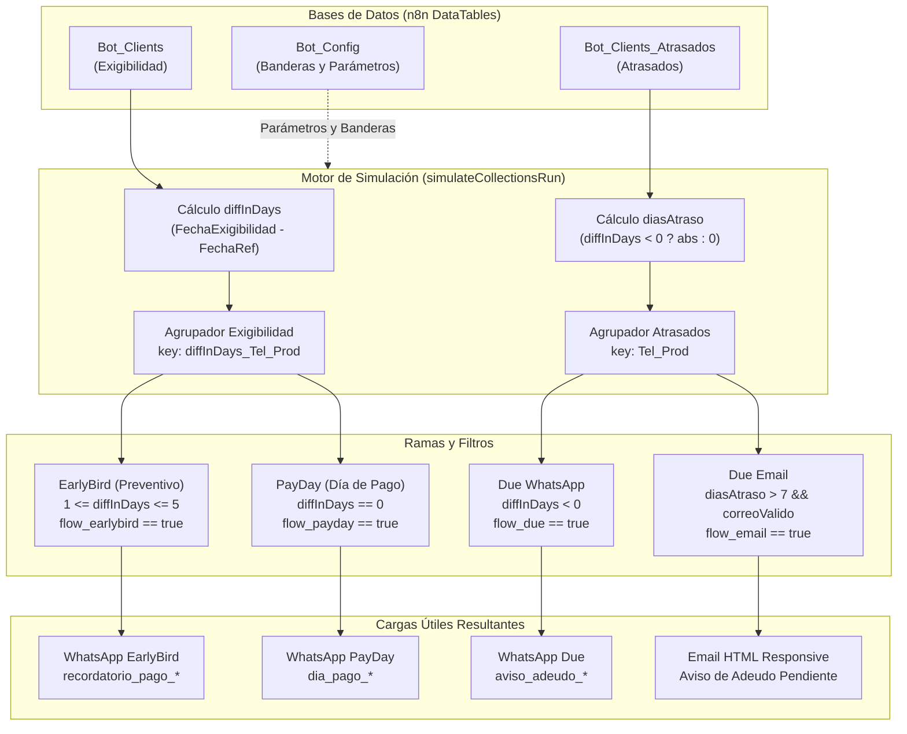

# Motor de Simulación de Cobranza (WhatsApp & Email)

Este documento detalla la arquitectura, las fórmulas matemáticas, las reglas de agrupación y la integración técnica del motor de simulación de cobranza implementado en [`src/services/collectionsSimulator.ts`](file:///D:/AICode/VRDemons/vandelierai.com/src/services/collectionsSimulator.ts).

El motor replica con exactitud matemática el comportamiento del workflow principal de n8n:
- **ID del workflow:** `X125742MSwzmjy4Z` (*Cobranza VR Demons - WhatsApp API*)
- **Tablas de datos fuente:**
  - `Bot_Clients` (`H3fj5bUAAZK83wqY`): Cartera de Exigibilidad (Preventivos y Día de Pago).
  - `Bot_Clients_Atrasados` (`czLf6vCR4KpbPDVo`): Cartera Vencida (Atrasados).
  - `Bot_Config` (`KTOr37TRGOev8Ywa`): Banderas de activación, teléfonos de prueba y credenciales.

---

## 1. Arquitectura de Flujos y Canales



---

## 2. Reglas Matemáticas y de Agrupación

### A. Normalización de Fechas y Cálculo de Diferencia
Para evitar errores de horario de verano o discrepancias horarias entre servidor y cliente, ambas fechas se truncan a las `00:00:00.000` horas locales (`America/Mexico_City`):

$$\text{dateA} = \text{new Date}(\text{FechaExigibilidad}).\text{setHours}(0, 0, 0, 0)$$
$$\text{dateRef} = \text{new Date}(\text{FechaReferencia}).\text{setHours}(0, 0, 0, 0)$$
$$\text{diffInDays} = \text{Math.round}\left(\frac{\text{dateA} - \text{dateRef}}{24 \times 60 \times 60 \times 1000}\right)$$

### B. Claves de Agrupación (`Group Keys`)

1. **Exigibilidad (EarlyBird y PayDay):**
   $$\text{groupKey} = \text{diffInDays} + \text{"\_"} + \text{Telefono} + \text{"\_"} + \text{Producto}$$
   *Razón:* Si un cliente tiene folios que vencen en días distintos (ej. 2 días vs 5 días), no deben mezclarse en un mismo mensaje preventivo, ya que su fecha límite es diferente. Si tiene múltiples folios que vencen el mismo día, se agrupan en un único mensaje multi-operación.

2. **Atrasados (Due WhatsApp y Due Email):**
   $$\text{groupKey} = \text{Telefono} + \text{"\_"} + \text{Producto}$$
   *Razón:* Todos los adeudos vencidos del cliente para un producto se consolidan en un único estado de cuenta global, sin importar cuántos días de mora individuales tenga cada folio.

### C. Regla de los 7 Días para Correo Electrónico
El flujo de correo de mora solo se activa si se cumplen **todas** las siguientes condiciones:
1. `diasAtraso > 7` (al menos un folio tiene más de una semana de atraso).
2. Correo electrónico válido (no vacío y contiene `@`).
3. `flow_email.value === true`.

---

## 3. Matriz de Plantillas de WhatsApp (Meta Cloud API)

| Flujo | Personalidad | Cantidad de Folios | Nombre de Plantilla | Variables Clave |
| :--- | :--- | :---: | :--- | :--- |
| **EarlyBird** | FÍSICA | 1 | `recordatorio_pago_fisica_1` | `header_1`, `nombre_contacto`, `tipo_producto`, `numero_folio`, `fecha_exigibilidad`, `monto_total`, `fecha_limite`, `numero_referencia` |
| **EarlyBird** | MORAL | 1 | `recordatorio_pago_moral_1` | *Mismas que física* + `nombre_empresa` |
| **EarlyBird** | FÍSICA | > 1 | `recordatorio_pago_fisica_multi` | `header_1`, `nombre_contacto`, `lista_operaciones`, `referencias_combinadas` |
| **EarlyBird** | MORAL | > 1 | `recordatorio_pago_moral_multi` | *Mismas que física multi* + `nombre_empresa` |
| **PayDay** | FÍSICA | 1 | `dia_pago_fisica_1` | `header_1`, `contacto`, `producto`, `folio`, `total`, `referencia` |
| **PayDay** | MORAL | 1 | `dia_pago_moral_1` | *Mismas que física* + `empresa` |
| **PayDay** | FÍSICA | > 1 | `dia_pago_fisica_multi` | `header_1`, `contacto`, `lista_operaciones`, `referencias` |
| **PayDay** | MORAL | > 1 | `dia_pago_moral_multi` | *Mismas que física multi* + `empresa` |
| **Due (Atrasados)** | FÍSICA | 1 a N | `aviso_adeudo_fisica` | `header_1`, `cliente`, `producto`, `lista_adeudos`, `referencias` |
| **Due (Atrasados)** | MORAL | 1 a N | `aviso_adeudo_moral` | `header_1`, `contacto`, `producto`, `empresa`, `lista_adeudos`, `referencias` |

### Control del Límite de Caracteres en Adeudos (Meta 1024 char budget)
Para clientes con decenas de contratos vencidos (ej. 15 folios), la lista de adeudos excedería el límite de 1024 caracteres de WhatsApp. El motor aplica un presupuesto de truncamiento:
- **$\le 3$ folios:** Se listan todos detalladamente: `. Folio 123456 - Fecha Límite: 20-oct - $15,000.00 MXN`.
- **$> 3$ folios:** Se listan los 3 adeudos más representativos y se añade una línea de consolidación: `. (+N adeudos más: $TOTAL_RESTANTE)`.
- **Referencias:** Si la cadena de folios supera los 90 caracteres, se trunca a los primeros 4 más `(+N más)`.

---

## 4. Especificación del Correo Electrónico (`Due Email`)

- **Remitente:** `sistemasvandelier@gmail.com`
- **Destinatario:** `group.Email`
- **Asunto:** `Aviso de Adeudo Pendiente - [Producto] (Ref: [Folios])`
- **Contenido:**
  - Encabezado corporativo institucional Vandelier `#0d1b2a`.
  - Saludo formal a la persona física o representante legal con razón social.
  - Tabla desglosada con **Folio**, **Fecha Límite** y **Total Adeudo**.
  - Fila final con **Total Pendiente** resaltado.
  - Bloque bancario oficial para liquidación inmediata:
    - **Titular:** BANCO COVALTO SA DE IBM FID 1444
    - **Banco:** BBVA
    - **Cuenta:** 0125218543
    - **CLABE:** 012180001252185431
    - **Referencia:** Folios del contrato
    - **Fecha Límite:** `INMEDIATO`
  - Apercibimiento legal sobre reporte a Sociedades de Información Crediticia (Buró de Crédito).

---

## 5. Guía de Integración para la Interfaz de Usuario (React / UI)

La función [`simulateCollectionsRun`](file:///D:/AICode/VRDemons/vandelierai.com/src/services/collectionsSimulator.ts#L170-L460) es una función pura, sin efectos secundarios, TypeScript-first y completamente desacoplada de la red.

### Ejemplo de Integración en Componente React

```tsx
import React, { useState, useMemo } from 'react';
import { simulateCollectionsRun, SimulationResult } from '../services/collectionsSimulator';

export const CollectionsSimulatorModal: React.FC<{
  isOpen: boolean;
  onClose: () => void;
  exigibilidadData: any[];
  atrasadosData: any[];
  config: any;
}> = ({ isOpen, onClose, exigibilidadData, atrasadosData, config }) => {
  const [selectedDate, setSelectedDate] = useState<string>(() => {
    // Por defecto mañana a las 9:00 AM
    const d = new Date();
    d.setDate(d.getDate() + 1);
    return d.toISOString().split('T')[0];
  });
  const [filterFlow, setFilterFlow] = useState<'ALL' | 'EarlyBird' | 'PayDay' | 'Due'>('ALL');
  const [filterChannel, setFilterChannel] = useState<'ALL' | 'WHATSAPP' | 'EMAIL'>('ALL');

  // Ejecuta la simulación de forma instantánea en memoria (O(N))
  const simResult: SimulationResult = useMemo(() => {
    return simulateCollectionsRun(
      exigibilidadData,
      atrasadosData,
      config,
      {
        referenceDate: `${selectedDate}T09:00:00-06:00`,
        timeZone: 'America/Mexico_City'
      }
    );
  }, [exigibilidadData, atrasadosData, config, selectedDate]);

  if (!isOpen) return null;

  return (
    <div className="fixed inset-0 bg-black/60 backdrop-blur-sm z-50 flex items-center justify-center p-4">
      <div className="bg-slate-900 border border-slate-800 rounded-2xl w-full max-w-5xl max-h-[90vh] flex flex-col shadow-2xl">
        {/* Header con métricas */}
        <div className="p-6 border-b border-slate-800 flex justify-between items-center">
          <div>
            <h3 className="text-xl font-bold text-white">Simulador de Cobranza en Vivo</h3>
            <p className="text-sm text-slate-400">
              Proyección de envíos para: <strong>{simResult.summary.referenceDateLocal}</strong>
            </p>
          </div>
          <input
            type="date"
            value={selectedDate}
            onChange={(e) => setSelectedDate(e.target.value)}
            className="bg-slate-800 text-white border border-slate-700 rounded-lg px-3 py-1.5 text-sm"
          />
        </div>

        {/* Tarjetas KPI */}
        <div className="grid grid-cols-4 gap-4 p-6 bg-slate-950/50">
          <div className="bg-slate-800/60 p-4 rounded-xl border border-slate-700/50">
            <span className="text-xs text-slate-400 font-medium">Preventivos (EarlyBird)</span>
            <div className="text-2xl font-bold text-emerald-400">{simResult.summary.countsByFlow.earlyBird} msgs</div>
            <span className="text-xs text-slate-500">{simResult.summary.foliosByFlow.earlyBird} folios</span>
          </div>
          <div className="bg-slate-800/60 p-4 rounded-xl border border-slate-700/50">
            <span className="text-xs text-slate-400 font-medium">Día de Pago (PayDay)</span>
            <div className="text-2xl font-bold text-blue-400">{simResult.summary.countsByFlow.payDay} msgs</div>
            <span className="text-xs text-slate-500">{simResult.summary.foliosByFlow.payDay} folios</span>
          </div>
          <div className="bg-slate-800/60 p-4 rounded-xl border border-slate-700/50">
            <span className="text-xs text-slate-400 font-medium">Atrasados (WhatsApp)</span>
            <div className="text-2xl font-bold text-amber-400">{simResult.summary.countsByFlow.dueWhatsApp} msgs</div>
            <span className="text-xs text-slate-500">{simResult.summary.foliosByFlow.dueWhatsApp} folios</span>
          </div>
          <div className="bg-slate-800/60 p-4 rounded-xl border border-slate-700/50">
            <span className="text-xs text-slate-400 font-medium">Atrasados (Email >7d)</span>
            <div className="text-2xl font-bold text-purple-400">{simResult.summary.countsByFlow.dueEmail} correos</div>
            <span className="text-xs text-slate-500">{simResult.summary.foliosByFlow.dueEmail} folios</span>
          </div>
        </div>

        {/* Tabla de Mensajes */}
        <div className="flex-1 overflow-auto p-6">
          <table className="w-full text-left text-sm text-slate-300">
            <thead className="text-xs uppercase bg-slate-800 text-slate-400 sticky top-0">
              <tr>
                <th className="p-3">Flujo</th>
                <th className="p-3">Producto</th>
                <th className="p-3">Cliente</th>
                <th className="p-3">Destino</th>
                <th className="p-3">Folios</th>
                <th className="p-3 text-right">Monto</th>
                <th className="p-3">Plantilla / Asunto</th>
              </tr>
            </thead>
            <tbody className="divide-y divide-slate-800">
              {simResult.whatsAppMessages.map((m, idx) => (
                <tr key={`wa-${idx}`} className="hover:bg-slate-800/30">
                  <td className="p-3"><span className="px-2 py-0.5 rounded text-xs bg-emerald-950 text-emerald-400 border border-emerald-800">{m.flow}</span></td>
                  <td className="p-3">{m.producto}</td>
                  <td className="p-3 font-medium text-white">{m.cliente}</td>
                  <td className="p-3 font-mono text-xs">{m.phone}</td>
                  <td className="p-3">{m.folios.join(', ')} ({m.foliosCount})</td>
                  <td className="p-3 text-right font-semibold text-emerald-300">{m.totalFormatted}</td>
                  <td className="p-3 font-mono text-xs text-slate-400">{m.template}</td>
                </tr>
              ))}
              {simResult.emails.map((e, idx) => (
                <tr key={`em-${idx}`} className="hover:bg-slate-800/30">
                  <td className="p-3"><span className="px-2 py-0.5 rounded text-xs bg-purple-950 text-purple-400 border border-purple-800">Email Due</span></td>
                  <td className="p-3">{e.producto}</td>
                  <td className="p-3 font-medium text-white">{e.cliente}</td>
                  <td className="p-3 font-mono text-xs">{e.toEmail}</td>
                  <td className="p-3">{e.referencias} ({e.foliosCount})</td>
                  <td className="p-3 text-right font-semibold text-purple-300">{e.totalFormatted}</td>
                  <td className="p-3 text-xs text-slate-400 truncate max-w-xs">{e.subject}</td>
                </tr>
              ))}
            </tbody>
          </table>
        </div>
      </div>
    </div>
  );
};
```

---

## 6. Pruebas Unitarias
El motor cuenta con cobertura unitaria completa en [`tests/unit/collectionsSimulator.test.ts`](file:///D:/AICode/VRDemons/wacrm_vandelier/tests/unit/collectionsSimulator.test.ts) y [`tests/unit/api-public-schedule.test.ts`](file:///D:/AICode/VRDemons/wacrm_vandelier/tests/unit/api-public-schedule.test.ts), validando:
- Clasificación de preventivos (1 a 5 días)
- Clasificación de día de pago (0 días)
- Regla de mora por WhatsApp y correo electrónico (> 7 días)
- Agrupación automática de múltiples contratos por cliente y producto
- Selección correcta de plantillas singulares vs múltiples
- Filtro dinámico por tipo de flujo (`flow=EarlyBird`, `flow=PayDay`, etc.)
- Resolución automática del próximo cron y normalización de zona horaria (`America/Mexico_City`)

---

## 7. Endpoints de la API REST (`getschedule` / `schedule`)

El motor está expuesto en el CRM mediante las siguientes rutas equivalentes:
- `GET /api/public/v1/schedule`
- `GET /api/public/v1/getschedule`
- `GET /api/schedule`
- `POST /api/public/v1/schedule` (para simulación con carteras o configuraciones personalizadas)

### Parámetros Configurables

| Parámetro | Query Param / Body | Por Defecto | Descripción y Valores Aceptados |
| :--- | :--- | :--- | :--- |
| **Día / Fecha** | `date`, `dia`, `referenceDate` | **El próximo cron** (`next`) | Si la hora local actual en la zona horaria es $\ge$ 9:00 AM, calcula automáticamente las 9:00 AM del día siguiente; si es menor, calcula las 9:00 AM de hoy. Acepta: `'next'`, `'today'`, `'tomorrow'`, o fechas ISO/`YYYY-MM-DD` (ej. `'2026-11-02'`). |
| **Tipo de Flujo** | `flow`, `flujo`, `tipo_flujo`, `flows` | **`ALL`** (todos) | Filtra los mensajes resultantes. Valores: `'ALL'`, `'EarlyBird'` (o `'Preventivo'`), `'PayDay'` (o `'Dia_Pago'`), `'Due'` (o `'Atrasados'`), `'Email'` (o `'Correo'`). Permite listas separadas por coma (ej. `flow=EarlyBird,PayDay`). |
| **Zona Horaria** | `timeZone`, `timezone`, `tz`, `zona_horaria` | **`America/Mexico_City`** | Zona horaria para el cálculo de fecha y horas locales. Acepta alias como `'mexico'`, `'cdmx'`, `'mx'`. |
| **Origen de Datos** | `source` | **`auto`** | `'auto'` (intenta n8n DataTables y recurre a la BD local si falla), `'n8n'` (exclusivo n8n DataTables) o `'db'` (tabla `contact_folio` de PostgreSQL). |

### Ejemplos de Petición cURL

#### 1. Consulta estándar para el próximo cron (todo por defecto: próximo día, todos los flujos, hora de México):
```bash
curl -X GET "https://crm.vandelierai.com/api/public/v1/schedule" \
  -H "x-api-key: TU_API_KEY"
```

#### 2. Filtrar solo Día de Pago (PayDay) para el próximo lunes en horario de México:
```bash
curl -X GET "https://crm.vandelierai.com/api/public/v1/schedule?date=2026-11-02&flow=PayDay&timezone=mexico" \
  -H "x-api-key: TU_API_KEY"
```

#### 3. Simulación POST en vivo desde interfaz o script con datos propios:
```bash
curl -X POST "https://crm.vandelierai.com/api/public/v1/schedule" \
  -H "x-api-key: TU_API_KEY" \
  -H "Content-Type: application/json" \
  -d '{
    "date": "tomorrow",
    "flow": "EarlyBird",
    "timezone": "America/Mexico_City",
    "exigibilidadClients": [
      {
        "Folio": 101,
        "Cliente": "Empresa Alfa",
        "Contacto": "Juan",
        "FechaExigibilidad": "2026-11-04T18:00:00.000Z",
        "Producto": "ARRENDAMIENTO",
        "Total": 50000,
        "Telefono": "5511223344",
        "Personalidad": "MORAL"
      }
    ],
    "config": {
      "flow_earlybird": true,
      "test_mode": false
    }
  }'
```

