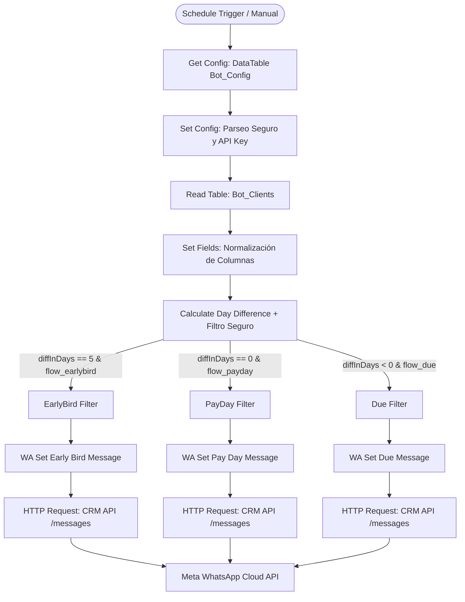

# Automatización de Cobranza n8n con WhatsApp Business API — Vandelier CRM

Este documento detalla la arquitectura, configuración, catálogo de plantillas, aprendizajes técnicos y guía de operación del flujo automatizado de cobranza y recordatorios en **n8n** integrado con la API pública de **Vandelier CRM**.

---

## 1. 🏗️ Arquitectura General



### Componentes:
- **Workflow n8n**: `Cobranza VR Demons (Whatsapp API)` (ID: `X125742MSwzmjy4Z`)
- **Instancia n8n**: `https://n8n.vandelierai.com`
- **CRM Endpoint**: `POST https://crm.vandelierai.com/api/public/v1/messages`
- **Autenticación**: Cabecera `x-api-key: {{ $('Set Config').first().json.crm_api_key.value }}`
- **DataTables**:
  - `Bot_Config` (`KTOr37TRGOev8Ywa`): Configuración operativa, llaves y modo de prueba.
  - `Bot_Clients` (`H3fj5bUAAZK83wqY`): Cartera de clientes y contratos con saldo pendiente.

---

## 2. 🎛️ Configuración y Variables en `Bot_Config`

| Clave (`key`) | Tipo | Ejemplo | Descripción |
|---|---|---|---|
| `crm_api_key` | String | `sk_live_...` | API Key pública del CRM con permisos de mensajería. |
| `test_mode` | Boolean / String | `"true"` | Modo seguro: aísla clientes reales y fuerza envío exclusivo a `test_phone`. |
| `test_phone` | String | `"+525510163879"` | Número autorizado para recibir pruebas de WhatsApp. |
| `flow_earlybird`| Boolean / String | `"true"` | Habilita/deshabilita la rama de recordatorios preventivos (-5 días). |
| `flow_payday` | Boolean / String | `"true"` | Habilita/deshabilita la rama del día de vencimiento (hoy). |
| `flow_due` | Boolean / String | `"true"` | Habilita/deshabilita la rama de adeudos vencidos. |
| `flow_email` | Boolean / String | `"false"` | Controla la rama secundaria de notificaciones por correo electrónico. |

### Parseo Seguro en `Set Config`:
El nodo `Set Config` procesa tanto valores booleanos/números JSON como strings de texto plano para evitar que valores como `crm_api_key` o números con `+` rompan el flujo:
```javascript
let parsedVal = item.value;
try {
  parsedVal = JSON.parse(item.value);
} catch (e) {
  parsedVal = item.value;
}
```

---

## 3. 📋 Matriz de Plantillas Oficiales de Meta Cloud API

| Momento | Caso | Personalidad | Volumen | Plantilla Meta | Variables Requeridas |
|---|:---:|:---:|:---:|---|---|
| **Early Bird** (-5 días) | C1 | Física | 1 crédito | `recordatorio_pago_fisica_1` | `header_1`, `nombre_contacto`, `tipo_producto`, `numero_folio`, `fecha_exigibilidad`, `monto_total`, `fecha_limite`, `numero_referencia` |
| | C2 | Física | 1 crédito (Arrend.) | `recordatorio_pago_fisica_1` | *(Idem con `tipo_producto: "arrendamiento"`)* |
| | C3 | Física | 2+ créditos | `recordatorio_pago_fisica_multi` | `header_1`, `nombre_contacto`, `lista_operaciones`, `referencias` |
| | C4 | Moral | 1 crédito | `recordatorio_pago_moral_1` | `header_1`, `nombre_contacto`, `tipo_producto`, `numero_folio`, `nombre_empresa`, `fecha_exigibilidad`, `monto_total`, `fecha_limite`, `numero_referencia` |
| | C5 | Moral | 2+ créditos | `recordatorio_pago_moral_multi` | `header_1`, `nombre_contacto`, `nombre_empresa`, `lista_operaciones`, `referencias` |
| **Pay Day** (Hoy) | C6 | Física | 1 crédito (Préstamo) | `dia_pago_fisica_1` | `header_1`, `contacto`, `producto`, `folio`, `total`, `referencia` |
| | C7 | Física | 1 crédito (Arrend.) | `dia_pago_fisica_1` | *(Idem con `producto: "arrendamiento"`)* |
| | C8 | Física | 2+ créditos | `dia_pago_fisica_multi` | `header_1`, `contacto`, `lista_operaciones`, `referencias` |
| | C9 | Moral | 1 crédito | `dia_pago_moral_1` | `header_1`, `contacto`, `producto`, `folio`, `empresa`, `total`, `referencia` |
| | C10 | Moral | 2+ créditos | `dia_pago_moral_multi` | `header_1`, `contacto`, `empresa`, `lista_operaciones`, `referencias` |
| **Due** (Vencido) | C11 | Física | 1 crédito | `aviso_adeudo_fisica` | `cliente`, `producto`, `lista_adeudos`, `referencias` |
| | C12 | Física | 2+ créditos | `aviso_adeudo_fisica` | *(Idem con lista consolidada en 1 línea)* |
| | C13 | Moral | 1 crédito | `aviso_adeudo_moral` | `contacto`, `producto`, `empresa`, `lista_adeudos`, `referencias` |
| | C14 | Moral | 2+ créditos | `aviso_adeudo_moral` | *(Idem con lista consolidada en 1 línea)* |

---

## 4. 💡 Aprendizajes Técnicos Críticos (Gotchas y Reglas de Oro)

### 1. `immediate: true` obligatorio para envíos en tiempo real
- **Comportamiento**: Si se envía `immediate: false` (o se omite), la API del CRM no contacta a Meta; guarda el mensaje en la tabla `outboxMessage` con `status: "pending"` y devuelve `queueIds: [...]`.
- **Impacto**: El mensaje queda esperando al cron interno (`/api/internal/cron/process-outbox`) y no se entrega en WhatsApp de inmediato.
- **Regla**: Los nodos preparadores (`WA Set ... Message`) deben fijar siempre `immediate: true` para que devuelva `sentMessageIds: [...]` y dispare Meta Cloud API al segundo.

### 2. Límite de 20 caracteres por nombre de variable en Meta Cloud API
- **Problema**: Meta rechaza nombres de variable que excedan 20 caracteres (`Param template.components.parameters.parameter_name must be at most 20 characters long`).
- **Caso encontrado**: La variable `{{referencias_combinadas}}` tiene **22 caracteres**.
- **Solución**: Renombrar a `{{referencias}}` (11 caracteres) en Meta Business Suite, tal como ya funciona en `dia_pago_moral_multi` y `dia_pago_fisica_multi`.

### 3. Error Meta #132018 (Cero saltos de línea `\n` en parámetros)
- **Problema**: Meta Cloud API prohíbe terminantemente saltos de línea (`\n`, `\r`) dentro del texto de variables de plantilla.
- **Solución**: Todo desglose multilínea de folios o adeudos se sanitiza forzosamente con:
  ```javascript
  text.replace(/[\r\n]+/g, " — ").trim();
  ```

### 4. Forzar Charset UTF-8 en Cabeceras HTTP
- **Problema**: Windows PowerShell y algunos clientes HTTP usan ISO-8859-1 por defecto, provocando mojibake (ej. `"prstamo"` en lugar de `"préstamo"`).
- **Solución**: El nodo HTTP de n8n debe declarar explícitamente:
  `Content-Type: application/json; charset=utf-8`.

### 5. Gramática de Plantillas (Evitar Stuttering "del el")
- **Problema**: El cuerpo de las plantillas oficiales de Meta ya incluye la preposición contracta `"del "` (ej. `"el pago del {{producto}} número..."`).
- **Solución**: Enviar `"préstamo"` o `"arrendamiento"` directamente sin artículo. En los avisos de adeudo vencido (`aviso_adeudo_*`), la plantilla no tiene `"del "`, por lo que allí sí se utiliza `"el préstamo"` / `"los préstamos"`.

### 6. Sincronización Obligatoria de Plantillas en CRM
- Si una plantilla existe y está aprobada en Meta pero no se ha descargado a la base de datos de PostgreSQL del CRM, la API devolverá `Template not found: 'nombre_plantilla'`.
- Para resolverlo: Entrar a [crm.vandelierai.com/settings](https://crm.vandelierai.com/settings) y pulsar **"Sincronizar Plantillas"**.

---

## 5. 🛡️ Arquitectura de Seguridad para Pruebas (Triple Capa)

Para evitar bajo cualquier circunstancia envíos accidentales a clientes reales durante pruebas o desarrollo:

1. **Capa 1 (Filtro en Origen en `Calculate Day Difference`)**:
   Cuando `test_mode: "true"`, descarta en memoria todos los registros de la base de datos que no coincidan con el teléfono de prueba o folios de prueba (`9990`-`9999`).
2. **Capa 2 (Sobrescritura Forzosa)**:
   En los 3 nodos preparadores, la variable `phone` se asigna obligatoriamente a `config.test_phone`.
3. **Capa 3 (Limitador de Volumen)**:
   En modo prueba, se aplica un corte `[results[0]]` para no emitir ráfagas repetidas.
4. **Pinned Data Controlada**:
   Se fijaron en `Calculate Day Difference` exactamente 3 registros (Early Bird, Pay Day, Due) apuntando al número de prueba para pruebas directas en el editor de n8n.

---

## 6. 🚀 Guía de Operación y Paso a Producción

Cuando se decida operar en producción con cartera real:

1. **Sincronizar Plantillas**:
   Verificar que Meta haya aprobado las plantillas pendientes (`aviso_adeudo_fisica`, `aviso_adeudo_moral`, y el renombre a `{{referencias}}`) y pulsar **"Sincronizar Plantillas"** en Ajustes del CRM.
2. **Cambiar `test_mode` a `"false"`**:
   En la DataTable `Bot_Config`, editar el registro `test_mode` y cambiar su valor a `"false"`.
3. **Desanclar Pinned Data**:
   En el nodo `Calculate Day Difference`, hacer clic en "Unpin data" para que tome la lectura viva de `Bot_Clients`.
4. **Activar Workflow**:
   Activar el switch general del workflow en n8n para que el `Schedule Trigger` se ejecute diariamente a la hora programada.
