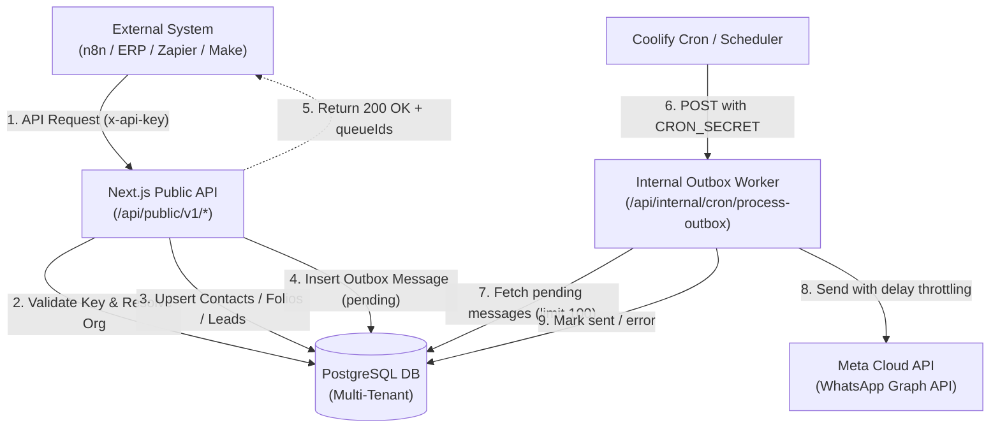

# Vocero CRM — Public External API Reference (`v1`)

The Public External API (`/api/public/v1/*`) allows external systems—such as **n8n**, **Zapier**, **Make**, billing systems, core banking platforms, and custom ERPs—to interact with Vocero CRM.

It enables external systems to:
1. Ingest and synchronize customer contacts (single or batch).
2. Attach external debt/financial folios to customer profiles.
3. Queue outbound WhatsApp messages safely without execution timeouts or hitting Meta rate limits.
4. Programmatically advance leads through stages on the Kanban pipeline.
5. Trigger automated WhatsApp templates with variable interpolation and automatic pipeline stage progression.

---

## Architecture & Data Flow

Vocero CRM implements an **asynchronous outbox pattern** for outbound messaging. External systems push messages or automation payloads to the CRM database outbox. A background worker processes the queue sequentially, adhering to the organization's configured sending delay.



---

## Authentication

All requests to `/api/public/v1/*` require an API key passed in the `x-api-key` HTTP header.

```http
x-api-key: sk_live_your_api_key_here
```

### Key Characteristics
- **Format**: `sk_live_<64-character-hex-string>` (e.g., `sk_live_a1b2c3d4e5f6...`).
- **Management**: Generated and revoked in the web UI under **Settings → Developer**.
- **Security**: The database only stores a cryptographic SHA-256 hash (`keyHash`) and a 12-character prefix (`prefix`) for quick lookup. Plaintext keys cannot be recovered once created.
- **Tenant Scope**: Every API key is strictly tied to a single `organization_id`. All operations are automatically scoped to that organization.

### Authentication Errors
If the header is missing, invalid, or belongs to a deleted organization, the endpoint immediately returns HTTP `401 Unauthorized`:

```json
{
  "error": "Unauthorized"
}
```

---

## Base URL

```text
https://crm.vandelierai.com/api/public/v1
```
*(Or `https://<your-crm-domain>/api/public/v1` for local/staging deployments)*

All request bodies must use `Content-Type: application/json`.

---

## Endpoints

### 1. Ingest / Upsert Contacts

Create or update contact records. If a contact already exists with the same phone identity within the organization, their name and phone are updated (`onConflictDoUpdate`).

* **Method**: `POST`
* **Path**: `/api/public/v1/contacts`
* **Headers**:
  * `x-api-key: <API_KEY>`
  * `Content-Type: application/json`

#### Request Payload
Accepts either a single object or an array of objects for bulk ingestion.

| Field | Type | Required | Description |
|---|---|---|---|
| `name` | `string` | **Yes** | Full name or business name of the contact. |
| `phone` | `string` | **Yes** | Phone number including country code (e.g. `+5215512345678` or `5215512345678`). |

#### Example: Single Contact
```bash
curl -X POST https://crm.vandelierai.com/api/public/v1/contacts \
  -H "x-api-key: sk_live_..." \
  -H "Content-Type: application/json" \
  -d '{
    "name": "Jane Doe",
    "phone": "+5215512345678"
  }'
```

#### Example: Batch Ingestion
```bash
curl -X POST https://crm.vandelierai.com/api/public/v1/contacts \
  -H "x-api-key: sk_live_..." \
  -H "Content-Type: application/json" \
  -d '[
    { "name": "Jane Doe", "phone": "+5215512345678" },
    { "name": "Carlos Morales", "phone": "+5215587654321" }
  ]'
```

#### Response (`200 OK`)
```json
{
  "success": true,
  "summary": {
    "total": 2,
    "success": 2,
    "error": 0
  }
}
```

If any item fails validation, it is included in an `errors` array:
```json
{
  "success": true,
  "summary": {
    "total": 2,
    "success": 1,
    "error": 1
  },
  "errors": [
    {
      "contact": { "name": "Invalid Contact" },
      "error": "Missing name or phone"
    }
  ]
}
```

---

### 2. Ingest Folios (External Records)

Ingest financial, billing, or credit tracking records (folios) linked to contacts. Folios attach directly to contacts matched by phone.

* **Method**: `POST`
* **Path**: `/api/public/v1/folios`
* **Headers**:
  * `x-api-key: <API_KEY>`
  * `Content-Type: application/json`

#### Request Payload
Accepts a single folio object or an array of folios. Field names are tolerant of both lowercase and PascalCase.

| Field (aliases) | Type | Required | Description |
|---|---|---|---|
| `folio` / `Folio` | `number` | **Yes** | Unique external reference/invoice number. |
| `telefono` / `phone` / `Telefono` | `string` | **Yes** | Contact phone number to associate with the folio. |
| `producto` / `Producto` | `string` | No | Description of product or credit line. |
| `fechaExigibilidad` / `FechaExigibilidad` | `string` | No | Due date in ISO-8601 format (e.g. `2026-11-30T00:00:00Z`). |
| `total` / `Total` | `number` | No | Total amount due. |
| `mora` / `Mora` | `number` | No | Overdue balance or penalty amount. |
| `pagado` / `Pagado` | `boolean` | No | Payment completion status (`true` / `false`). |
| `cliente` / `Cliente` | `string` | No | Client name fallback. |
| `rfc` / `RFC` | `string` | No | Fiscal tax ID (e.g. Mexican RFC). |

#### Example: Ingesting Folios
```bash
curl -X POST https://crm.vandelierai.com/api/public/v1/folios \
  -H "x-api-key: sk_live_..." \
  -H "Content-Type: application/json" \
  -d '[
    {
      "Folio": 10423,
      "Telefono": "+5215512345678",
      "Producto": "Crédito Personal",
      "FechaExigibilidad": "2026-11-15T00:00:00Z",
      "Total": 2450.50,
      "Mora": 150.00,
      "Pagado": false,
      "Cliente": "Jane Doe"
    }
  ]'
```

#### Response (`200 OK`)
```json
{
  "success": true,
  "summary": {
    "total": 1,
    "success": 1
  }
}
```

---

### 3. Send Outbound Messages (Direct or Asynchronous Outbox)

Sends or queues outbound WhatsApp text messages to a customer. When sent, the message is stored in the database with `direction: "out"` and `origin: "operator"`, meaning **it appears in the CRM GUI inbox exactly as if sent by the human agent/operator from the web composer**, triggering real-time UI updates via Server-Sent Events (SSE).

* **Method**: `POST`
* **Path**: `/api/public/v1/messages`
* **Headers**:
  * `x-api-key: <API_KEY>`
  * `Content-Type: application/json`

> [!NOTE]
> **Meta 24-Hour Service Window Rule**:
> WhatsApp only allows free-form text messages to be sent if the customer messaged your number within the last 24 hours. If sending a cold message to a number that has never written before (or > 24 hours ago), Meta requires using an approved **WhatsApp Template** via `POST /api/public/v1/n8n/templates`. Once the user responds, free-form text messaging is unlocked.

#### Request Payload
Accepts a single message or an array of message objects. You can identify the recipient either by their **phone number** (which automatically resolves/creates the contact and conversation) or by their internal **contactId**.

| Field | Type | Required | Description |
|---|---|---|---|
| `phone` / `number` | `string` | **Yes** (or `contactId`) | Recipient's phone number with country code (e.g. `+5215512345678`). |
| `contactId` | `string` | **Yes** (or `phone`) | Existing contact ID (`ct_...`). |
| `message` / `text` | `string` | **Yes** | Text message content to send. |
| `immediate` | `boolean` | No | If `true`, sends the message immediately to Meta Graph API without waiting for the background cron. If `false` (default), enqueues into the outbox. |

#### Example: Send by Phone Number (Immediate)
```bash
curl -X POST https://crm.vandelierai.com/api/public/v1/messages \
  -H "x-api-key: sk_live_..." \
  -H "Content-Type: application/json" \
  -d '{
    "phone": "+5215512345678",
    "message": "Hola Jane, confirmamos la recepción de tu pago. ¡Gracias!",
    "immediate": true
  }'
```

#### Example: Queue in Outbox
```bash
curl -X POST https://crm.vandelierai.com/api/public/v1/messages \
  -H "x-api-key: sk_live_..." \
  -H "Content-Type: application/json" \
  -d '{
    "phone": "+5215512345678",
    "message": "Hola Jane, este mensaje se enviará por la cola en segundo plano."
  }'
```

#### Response (`200 OK`)
```json
{
  "success": true,
  "summary": {
    "total": 1,
    "success": 1,
    "error": 0
  },
  "sentMessageIds": [
    "msg_01HXYZ7890ABCDEF123456"
  ]
}
```
*(If queued via outbox, `queueIds` will be returned instead of `sentMessageIds`)*

---

### 4. Update Pipeline Stage

Moves a lead to a new stage on the Kanban board and writes an audit event to `lead_stage_event`.

* **Method**: `PUT`
* **Path**: `/api/public/v1/pipeline`
* **Headers**:
  * `x-api-key: <API_KEY>`
  * `Content-Type: application/json`

#### Request Payload

| Field | Type | Required | Description |
|---|---|---|---|
| `contactId` | `string` | **Yes** | Internal contact ID (`ct_...`). |
| `state` | `string` | **Yes** | Target stage kind (e.g. `lead`, `contacted`, `qualified`, `proposal`, `won`, `lost`). |
| `lossReason` | `string` | No | Required reason if `state == "lost"` (defaults to `"otro"` if omitted). |

#### Example: Move Lead to Won Stage
```bash
curl -X PUT https://crm.vandelierai.com/api/public/v1/pipeline \
  -H "x-api-key: sk_live_..." \
  -H "Content-Type: application/json" \
  -d '{
    "contactId": "ct_01HXYZ7890ABCDEF123456",
    "state": "won"
  }'
```

#### Example: Move Lead to Lost Stage
```bash
curl -X PUT https://crm.vandelierai.com/api/public/v1/pipeline \
  -H "x-api-key: sk_live_..." \
  -H "Content-Type: application/json" \
  -d '{
    "contactId": "ct_01HXYZ7890ABCDEF123456",
    "state": "lost",
    "lossReason": "precio_alto"
  }'
```

#### Response (`200 OK`)
```json
{
  "success": true
}
```
*(If the lead is already in the target stage, returns `{ "success": true, "message": "Already in target stage" }`)*

---

### 5. Automation Workflow: Contact + Folio + Template + Pipeline (`n8n / Templates`)

A high-level endpoint designed for workflow engines (like n8n). In a single API call for each record, it:
1. Resolves or creates the contact by phone or WhatsApp user ID (`waUserId`).
2. Ensures a conversation exists in the CRM inbox.
3. Automatically creates/updates the folio record if `folio` is provided.
4. Finds the pre-approved WhatsApp template by name and language.
5. If the template is mapped to a pipeline stage (`template.pipelineStageId`), automatically shifts the lead to that stage.
6. Enqueues the approved template with variables into the outbound queue.

* **Method**: `POST`
* **Path**: `/api/public/v1/n8n/templates`
* **Headers**:
  * `x-api-key: <API_KEY>`
  * `Content-Type: application/json`

#### Request Payload

```json
{
  "records": [
    {
      "phone": "+5215512345678",
      "name": "Jane Doe",
      "templateName": "recordatorio_vencimiento_v1",
      "templateLanguage": "es_MX",
      "templateVariables": {
        "1": "Jane",
        "2": "$2,450.50",
        "3": "15 de Noviembre"
      },
      "folio": 10423,
      "total": 2450.50,
      "fechaExigibilidad": "2026-11-15T00:00:00Z",
      "producto": "Crédito Personal"
    }
  ]
}
```

| Record Field | Type | Required | Description |
|---|---|---|---|
| `phone` | `string` | **Conditional** | Phone number with country code. *(Required if `waUserId` is not sent)* |
| `waUserId` | `string` | **Conditional** | Meta BSUID identifier. *(Required if `phone` is not sent)* |
| `name` | `string` | No | Contact display name. |
| `templateName` | `string` | **Yes** | Approved Meta WhatsApp template name. |
| `templateLanguage` | `string` | No | Language code (defaults to `"es_MX"`). |
| `templateVariables` | `object` | No | Map of numeric index to replacement string (`{"1": "...", "2": "..."}`). |
| `folio` | `number` | No | Folio number (triggers folio upsert when present). |
| `total`, `mora`, etc. | `any` | No | Additional folio fields passed through to folio upsert. |

#### Example
```bash
curl -X POST https://crm.vandelierai.com/api/public/v1/n8n/templates \
  -H "x-api-key: sk_live_..." \
  -H "Content-Type: application/json" \
  -d '{
    "records": [
      {
        "phone": "+5215512345678",
        "name": "Jane Doe",
        "templateName": "aviso_pago",
        "templateLanguage": "es_MX",
        "templateVariables": {
          "1": "Jane",
          "2": "$1,200.00"
        }
      }
    ]
  }'
```

#### Response (`200 OK`)
```json
{
  "success": true,
  "summary": {
    "total": 1,
    "success": 1,
    "error": 0
  },
  "queueIds": [
    "c985ec2f-0498-4c91-a185-115f5d63f0d4"
  ]
}
```

---

## Outbox Processing & Rate Throttling

Outbound messages created by `/messages` and `/n8n/templates` are stored in the `outbox_message` table with status `"pending"`.

### Cron Configuration
To process the outbox, set up a recurring task in Coolify or a system crontab:

* **Frequency**: Every minute (`* * * * *`).
* **Endpoint**: `POST /api/internal/cron/process-outbox`
* **Header**: `Authorization: Bearer <CRON_SECRET>`

```bash
curl -X POST https://crm.vandelierai.com/api/internal/cron/process-outbox \
  -H "Authorization: Bearer $CRON_SECRET"
```

### Rate Throttling (`outboxDelayLimit`)
Each organization has an `outbox_delay_limit` configuration (in milliseconds, default `1000ms`). The worker respects this delay between sending messages to prevent Meta Cloud API 429 rate limit errors or phone number spam flagging.

---

## Guide: Integrating with n8n

In an **n8n** workflow:

1. **Add an HTTP Request node**:
   - **Method**: `POST` (or `PUT` for `/pipeline`).
   - **URL**: `https://crm.vandelierai.com/api/public/v1/<endpoint>` (or your custom deployment domain).
   - **Authentication**: Generic Credential Type → `Header Auth` (or manually add header):
     - Name: `x-api-key`
     - Value: `sk_live_...`
2. **Send Body**:
   - **Send Body**: `true`
   - **Body Content Type**: `JSON`
   - **Specify Body**: Using JSON Expression / Fields.
3. **Error Handling**:
   - Enable **Never Error** under node settings if you want to inspect failed batch rows from the `summary` response.

---

## Summary of Status Codes

| Code | Meaning | Cause |
|---|---|---|
| `200 OK` | Success | Payload processed (check `summary.error` for partial item failures in batches). |
| `400 Bad Request` | Invalid Input | Malformed JSON or missing required fields (`records must be an array`, `Missing contactId or state`, etc.). |
| `401 Unauthorized` | Auth Failed | Missing, invalid, or revoked `x-api-key` header. |
| `404 Not Found` | Not Found | Lead or conversation record not found for the specified contact ID. |
| `500 Internal Error` | Server Error | Unhandled server error (details logged to server container). |

