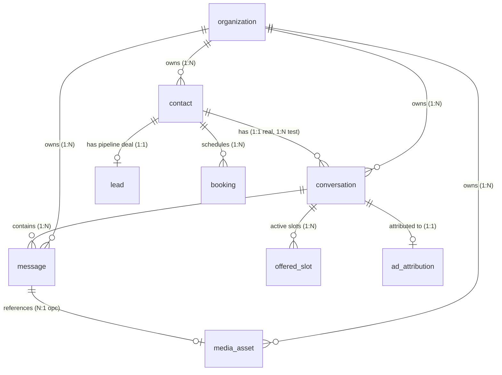

# Contact, Conversation & Message Database Entity Design

**Document Version**: 1.0.0  
**Target Repository**: `VRDemons/specs` (Vocero CRM / Vandelier AI)  
**Schema Definition**: [`src/lib/db/schema.ts`](file:///D:/AICode/VRDemons/wacrm_vandelier/src/lib/db/schema.ts)  
**Specifications**: [`001-vocero-core`](file:///D:/AICode/VRDemons/specs/001-vocero-core/data-model.md), [`003-paridad-inbox`](file:///D:/AICode/VRDemons/specs/003-paridad-inbox-whatsapp/spec.md), [`014-canal-instagram`](file:///D:/AICode/VRDemons/specs/014-canal-instagram/spec.md), [`017-canal-messenger`](file:///D:/AICode/VRDemons/specs/017-canal-messenger/spec.md), [`018-anuncio-de-origen`](file:///D:/AICode/VRDemons/specs/018-anuncio-de-origen/data-model.md)  

---

## 1. Relational Topology & Core Philosophy

In Vocero CRM, the interaction model is not a direct Contact-to-Message list. Instead, it places **`conversation` as the stateful transactional boundary** between a `contact` and its stream of `message` records.



---

## 2. Table-by-Table Architectural Schema

### 2.1 `contact` — Customer Cross-Channel Identity
A `contact` represents the customer entity communicating with the business. It decouples customer identity from any specific transient message thread.

* **Primary Key**: `id` (`text`, prefixed `ct_<nanoid>`).
* **Multi-Tenancy**: `organization_id` (`NOT NULL`, FK → `organization.id ON DELETE CASCADE`).
* **Cross-Channel Resolution (`wa_identity`)**:
  - **WhatsApp**: Normalized E.164 phone string (e.g., Mexican mobile prefix normalized `521...` → `52...`), or `bsuid:<id>` if Meta does not provide a phone number.
  - **Instagram** ([`014-canal-instagram`](file:///D:/AICode/VRDemons/specs/014-canal-instagram/spec.md)): `ig:<IGSID>`.
  - **Messenger** ([`017-canal-messenger`](file:///D:/AICode/VRDemons/specs/017-canal-messenger/spec.md)): `fb:<PSID>`.
  > [!NOTE]
  > The column name `wa_identity` is preserved because it is part of a published public contract consumed by external orchestrator bots via `GET /api/bot/context?waIdentity=...`.
* **Channel Discriminator**: `channel` (`'whatsapp' | 'instagram' | 'messenger'`, default `'whatsapp'`).
* **Compound Isolation Index**:
  ```ts
  uniqueIndex("contact_org_channel_identity_uq").on(
    t.organizationId,
    t.channel,
    t.waIdentity
  )
  ```
  Guarantees that an Instagram IGSID or Messenger PSID never collides with a WhatsApp phone number.
* **Extensible Lead Qualification (`ficha`)**:
  A `jsonb` field storing business-specific qualification data collected by an AI agent or external bot (`PUT /api/bot/ficha`). Avoids running database migrations whenever a business changes its qualification questionnaire.
* **Source Attribution (`source`)**:
  Enum: `'anuncio' | 'organico' | 'referido' | 'conocido' | 'otro'`.

---

### 2.2 `conversation` — Transactional State Machine
A `conversation` tracks the active state of interaction between an organization and a contact.

* **Primary Key**: `id` (`text`, prefixed `cv_<nanoid>`).
* **Foreign Keys**: `organization_id` (CASCADE) and `contact_id` (CASCADE).
* **Denormalized Channel (`channel`)**:
  Denormalized from `contact.channel` directly onto `conversation` to enable single-table index scans when rendering the inbox navigation and filtering by channel.
* **Partial Uniqueness Invariant**:
  ```ts
  uniqueIndex("conversation_org_contact_real_uq")
    .on(t.organizationId, t.contactId)
    .where(sql`${t.isTest} = false`)
  ```
  - **In Production**: Exactly **one** real conversation exists per contact (`1:1`).
  - **In El Laboratorio Sandbox (`is_test = true`)**: A contact can have **multiple** test conversations (`1:N`) simultaneously without corrupting the production inbox.
* **24-Hour Policy Window Tracking (`last_inbound_at`)**:
  Records the exact timestamp of the customer's last inbound message. The UI and API check `now() - last_inbound_at > 24 hours` to lock the free-form text composer and mandate approved template sending.
* **AI & Human Handoff State Machine**:
  - `ai_enabled`: Boolean toggle (allows disabling the AI per conversation).
  - `handoff_at`: Non-null timestamp silences the AI agent.
  - `handoff_reason`:
    - `'cliente'`: The customer asked for a human.
    - `'modelo'`: The LLM elected to escalate.
    - `'ventana'`: The 24-hour window closed.
    - `'error'`: Provider failure after retries.
    - `'hostilidad'`: Customer became verbally abusive.
    - `'manual_reply'`: **Coexistence trigger** — the business owner replied directly from the physical WhatsApp Business mobile app.

---

### 2.3 `message` — Immutable Message Audit Trail
Every interaction (text, media, location, contact card, or template) is committed as an immutable record in `message`.

* **Primary Key**: `id` (`text`, prefixed `msg_<nanoid>`).
* **Foreign Keys**:
  - `organization_id` (CASCADE)
  - `conversation_id` (CASCADE)
  - `media_asset_id` (`media_asset.id ON DELETE SET NULL`)
* **Principle IV (Idempotency)**:
  `wa_message_id text UNIQUE`:
  Every incoming webhook message ID (or outgoing delivery reference) is uniquely constrained. Duplicate Meta webhook deliveries trigger a no-op at the database level (`ON CONFLICT DO NOTHING`).
* **Direction & Status**:
  - `direction`: `'in' | 'out'`.
  - `status`: Monotonically progresses: `pending` → `sent` → `delivered` → `read` (or `failed`). Status updates cannot regress backwards.
* **Actor Attribution (`origin`)**:
  Spec [`003-paridad-inbox-whatsapp`](file:///D:/AICode/VRDemons/specs/003-paridad-inbox-whatsapp/spec.md) introduced `origin` to distinguish who initiated an outbound message:
  - `'ai'`: Generated by the automated AI agent.
  - `'operator'`: Sent by a human agent from the Vocero web inbox.
  - `'manual'`: Ingested from WhatsApp Coexistence echoes (`smb_message_echoes`) when the owner responds from their phone.
  - `'template'`: High-priority template sent across a closed 24-hour window.
* **Indexing**:
  ```ts
  index("message_org_conv_idx").on(t.organizationId, t.conversationId, t.createdAt)
  ```
  Guarantees sub-millisecond thread rendering and seamless pagination/SSE catch-up.

---

### 2.4 `media_asset` — Sovereign Attachment Storage
Under **Principio II (Soberanía / Self-Hosted)**, Vocero CRM strictly prohibits external cloud object stores (S3, Cloudflare R2, Google Cloud Storage).

* **Lifecycle**:
  1. Inbound attachments arrive via Meta Webhook with a `wa_media_id`.
  2. The webhook registers a `media_asset` with `fetch_status = 'pending'`.
  3. A background process downloads the binary directly from Graph API and writes it to `/data/media` (`MEDIA_DIR`).
  4. Once downloaded, `storage_path` is updated and `fetch_status = 'available'`.
  5. The binary is served strictly via authenticated session at `GET /api/media/[assetId]`.
* **Cross-Cutting Usage (Spec 018)**:
  [`018-anuncio-de-origen`](file:///D:/AICode/VRDemons/specs/018-anuncio-de-origen/data-model.md) reuses `media_asset` to cache Click-to-WhatsApp (CTWA) ad creative thumbnails locally. Multiple contacts arriving from the same advertisement share the identical `media_asset_id`.

---

## 3. Structural Class Diagram

```mermaid
classDiagram
    class Organization {
        +text id PK
        +text name
        +text metadata
    }

    class Contact {
        +text id PK "ct_*"
        +text organization_id FK
        +text channel "whatsapp | instagram | messenger"
        +text wa_identity "E.164 / bsuid / ig: / fb:"
        +text phone
        +text name
        +jsonb ficha
        +text source
        +timestamp archived_at
    }

    class Conversation {
        +text id PK "cv_*"
        +text organization_id FK
        +text contact_id FK
        +text channel
        +boolean is_test
        +boolean ai_enabled
        +timestamp handoff_at
        +text handoff_reason
        +timestamp last_inbound_at
        +timestamp last_message_at
        +integer unread_count
    }

    class Message {
        +text id PK "msg_*"
        +text organization_id FK
        +text conversation_id FK
        +text wa_message_id UK
        +text direction "in | out"
        +text type "text | image | audio..."
        +text text
        +text status "pending | sent | delivered | read"
        +boolean ai_generated
        +text origin "ai | operator | manual | template"
        +text media_asset_id FK
        +timestamp wa_timestamp
    }

    class MediaAsset {
        +text id PK "med_*"
        +text organization_id FK
        +text kind "image | video | audio | doc..."
        +text wa_media_id
        +text storage_path "/data/media/..."
        +text fetch_status "available | pending | failed"
    }

    class Lead {
        +text id PK "ld_*"
        +text contact_id FK UK
        +text stage_id FK
        +integer amount_cents
        +text priority
    }

    Organization "1" --> "*" Contact : cascades
    Organization "1" --> "*" Conversation : cascades
    Organization "1" --> "*" Message : cascades
    Organization "1" --> "*" MediaAsset : cascades

    Contact "1" --> "1..*" Conversation : 1 real, N test
    Contact "1" --> "0..1" Lead : 1:1 pipeline deal
    Conversation "1" --> "*" Message : ordered stream
    Message "0..1" --> "1" MediaAsset : optional attachment
```
