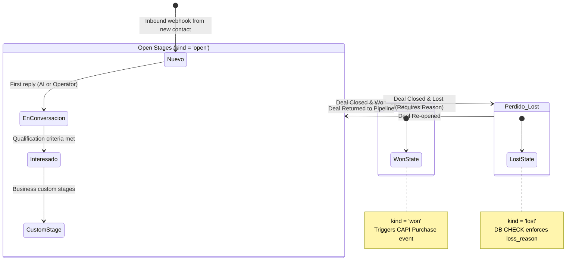
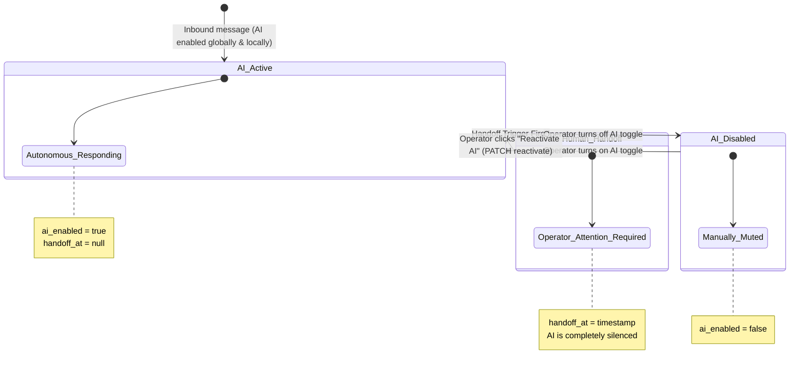

# Multi-Dimensional Contact State Machine

**Document Version**: 1.0.0  
**Target Repository**: `VRDemons/specs` (Vocero CRM / Vandelier AI)  
**Schema Implementation**: [`schema.ts`](file:///D:/AICode/VRDemons/wacrm_vandelier/src/lib/db/schema.ts)  
**Server Gatekeeper**: [`src/server/leads/stage-history.ts`](file:///D:/AICode/VRDemons/wacrm_vandelier/src/server/leads/stage-history.ts)  
**UI Controller**: [`src/components/inbox/contact-panel.tsx`](file:///D:/AICode/VRDemons/wacrm_vandelier/src/components/inbox/contact-panel.tsx)  

---

## 1. Overview of the Composite State Model

In Vocero CRM, the "current status" of a contact is not an isolated database column. It is evaluated as a composite state across four operational planes:

```
                               ┌───────────────────────────────────────────────┐
                               │            COMPOSITE CONTACT STATUS           │
                               └───────────────────────────────────────────────┘
                                                       │
         ┌─────────────────────────┬───────────────────┴───────────────────┬─────────────────────────┐
         ▼                         ▼                                       ▼                         ▼
┌─────────────────┐       ┌─────────────────┐                     ┌─────────────────┐       ┌─────────────────┐
│ Lifecycle State │       │ Commercial Stage│                     │ Handoff Status  │       │ 24-Hour Window  │
├─────────────────┤       ├─────────────────┤                     ├─────────────────┤       ├─────────────────┤
│ • Active        │       │ • Nuevo         │                     │ • AI Responding │       │ • Abierta       │
│ • Archived      │       │ • En conversa...│                     │ • Muted (Manual)│       │ • Por vencer    │
│                 │       │ • Interesado    │                     │ • Handoff (Meta,│       │ • Cerrada       │
│                 │       │ • Ganado (Won)  │                     │   cliente, echo)│       │   (Plantilla)   │
│                 │       │ • Perdido (Lost)│                     │                 │       │                 │
└─────────────────┘       └─────────────────┘                     └─────────────────┘       └─────────────────┘
```

---

## 2. Plane 1: The Commercial Pipeline State Machine (Funnel Lifecycle)

Every incoming contact is automatically assigned exactly one active `lead` (enforced by `uniqueIndex("lead_contact_uq")` in [`schema.ts`](file:///D:/AICode/VRDemons/wacrm_vandelier/src/lib/db/schema.ts#L225)).



### Stage Kinds & Invariants
* **`kind = 'open'`**: Standard operational stages (e.g., *Nuevo*, *En conversación*, *Interesado*). Leads can be dragged freely.
* **`kind = 'won'`**: Permanent anchor stage (*Cliente*). Represents closed business. If the `ATRIBUCION` flag is active ([Spec 016](file:///D:/AICode/VRDemons/specs/016-atribucion-capi/spec.md)), entering this stage triggers a Meta CAPI `Purchase` conversion event with `amount_cents`.
* **`kind = 'lost'`**: Permanent anchor stage (*Perdido*).

### The Inviolable Loss Reason Constraint (`lse_loss_reason_ck`)
A lead **cannot** be marked as lost without an explicit, audited reason. This is enforced directly in PostgreSQL via a check constraint:
```sql
ALTER TABLE lead_stage_event ADD CONSTRAINT lse_loss_reason_ck 
CHECK (to_stage_kind <> 'lost' OR approximate = true OR loss_reason IS NOT NULL);
```
Allowed loss reasons ([`src/lib/types.ts`](file:///D:/AICode/VRDemons/wacrm_vandelier/src/lib/types.ts)):
`'precio' | 'no_es_perfil' | 'sin_presupuesto' | 'eligio_otro' | 'nunca_contesto' | 'otro'`

### The Single-Door Gatekeeper (`moveLeadToStage`)
To prevent data drift in historical conversion reporting ([Spec 019](file:///D:/AICode/VRDemons/specs/019-resultados/spec.md)):
* **`lead.stage_id` can ONLY be written by [`src/server/leads/stage-history.ts`](file:///D:/AICode/VRDemons/wacrm_vandelier/src/server/leads/stage-history.ts#L54)**.
* Updating the stage and logging the historical snapshot in `lead_stage_event` occur in the **same atomic database transaction**.
* A surveillance unit test (`tests/unit/stage-history-guard.test.ts`) scans the codebase in CI and fails the build if any other file writes to `lead.stageId`.

---

## 3. Plane 2: The Conversational & AI Agent State Machine

Controls whether the autonomous AI agent or a human operator owns the conversation. Evaluated in [`src/components/inbox/contact-panel.tsx`](file:///D:/AICode/VRDemons/wacrm_vandelier/src/components/inbox/contact-panel.tsx#L55-L65).



### The 6 Handoff Triggers (`handoff_reason`)
When any of the following events occur, `handoff_at` is set to `now()`, the conversation displays an escalation badge, and the AI agent ceases execution:

| Handoff Reason | Description & Trigger Conditions |
|---|---|
| **`manual_reply`** | **The Coexistence Trigger** ([Spec 003](file:///D:/AICode/VRDemons/specs/003-paridad-inbox-whatsapp/spec.md)): The business owner replied directly from the physical WhatsApp Business app on their phone. An inbound echo (`smb_message_echoes`) immediately silences the AI so it doesn't talk over the owner. |
| **`cliente`** | Customer requested a human (e.g., *"quiero hablar con un asesor"*). Evaluated first by regex (which excludes false positives like *"somos 4 personas"*), then by LLM classification. |
| **`modelo`** | The AI agent autonomously decided to escalate based on configured escalation rules in `agent_profile`. |
| **`ventana`** | The Meta 24-hour service window closed; free-form AI text cannot be dispatched. |
| **`error`** | OpenRouter LLM gateway failure or invalid JSON extraction after 2 retries. |
| **`hostilidad`** | Customer exhibited aggressive or verbally abusive behavior. |

---

## 4. Plane 3: The 24-Hour Policy Window State Machine

Governed by Meta's WhatsApp & Instagram policies, this is calculated dynamically from `conversation.last_inbound_at`:

```mermaid
stateDiagram-v2
    [*] --> Window_Open : Customer sends inbound message
    
    state Window_Open {
        note right: now() - last_inbound_at < 20 hours<br/>Free-form text & media permitted
    }

    state Window_Expiring {
        note right: 20 to 24 hours elapsed<br/>UI warns operator (Resultados Spec 019)
    }

    state Window_Closed {
        note right: > 24 hours elapsed<br/>Composer blocked; AI silenced (reason: ventana)<br/>Requires Meta Template / HUMAN_AGENT tag
    }

    Window_Open --> Window_Expiring : 20 hours elapsed without inbound
    Window_Expiring --> Window_Closed : 24 hours reached
    Window_Closed --> Window_Open : Customer sends new inbound message
```

* **`Window_Open` (< 20h)**: AI and human operators can send standard text, images, video, and audio.
* **`Window_Expiring` (20h – 24h)**: Highlighted in the "Qué se está cayendo" panel of [`019-resultados`](file:///D:/AICode/VRDemons/specs/019-resultados/spec.md).
* **`Window_Closed` (> 24h)**:
  - For **WhatsApp**: Composer input is locked. Free-form text returns a `409 Conflict`. Dispatch is restricted to approved **Templates** ([Spec 001 US6](file:///D:/AICode/VRDemons/specs/001-vocero-core/spec.md)).
  - For **Instagram & Messenger** ([Specs 014](file:///D:/AICode/VRDemons/specs/014-canal-instagram/spec.md) & [017](file:///D:/AICode/VRDemons/specs/017-canal-messenger/spec.md)): Messages must carry the `HUMAN_AGENT` tag.

---

## 5. Plane 4: Contact Lifecycle & Archival State

Governed by `contact.archived_at`:

```mermaid
stateDiagram-v2
    [*] --> Active_Contact : Created via webhook / manual entry
    
    Active_Contact --> Archived_Contact : Operator archives contact (archived_at = now())
    Archived_Contact --> Active_Contact : Operator unarchives contact (archived_at = null)

    state Active_Contact {
        note right: Appears in default search, contact lists, and inbox
    }

    state Archived_Contact {
        note right: Hidden from main views<br/>All messages, leads, and history preserved
    }
```
